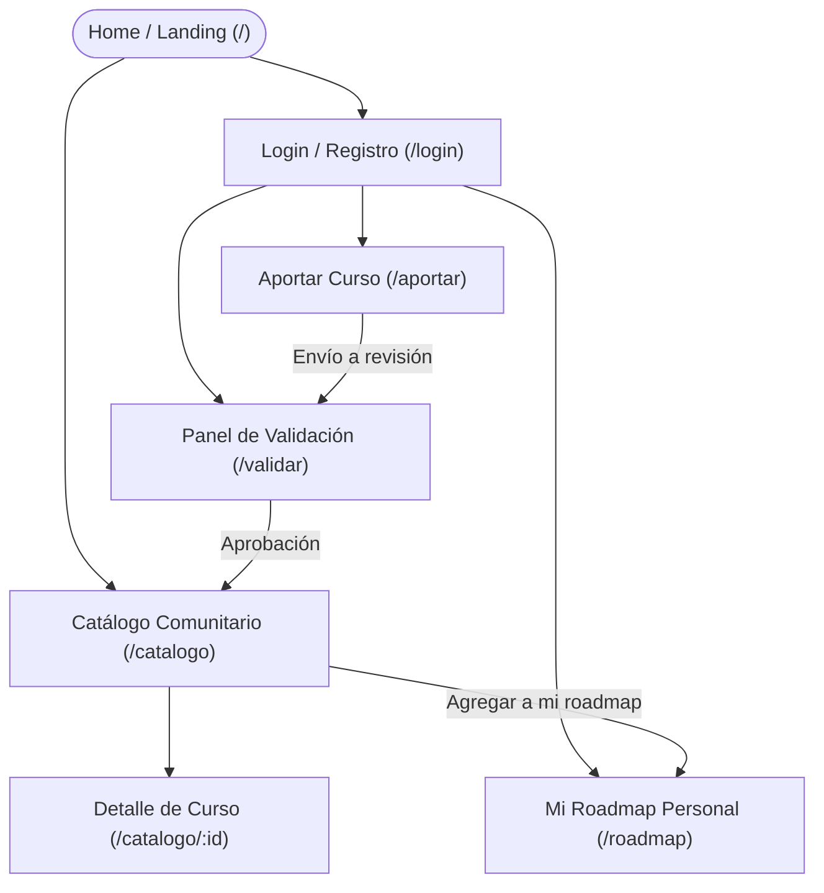

# APPFlow — Mapa del Sitio, Rutas y Flujos de Usuario — OpenRoadmap

> **Qué es:** Define la arquitectura de información, sitemap navegable, fichas de cada pantalla y los flujos de usuario extremo a extremo. Conecta las necesidades del usuario (PRD) con los contratos de API y persistencia (BackendSchema).

## 1. Sitemap General

## 2. Tabla de Rutas

| Ruta | Pantalla / Vista | Requiere Autenticación | Rol Mínimo | Propósito |
|------|------------------|------------------------|------------|-----------|
| `/` | Home / Landing | No | Público | Bienvenida, propuesta de valor, métricas destacadas y accesos directos al catálogo. |
| `/catalogo` | Catálogo Comunitario | No | Público | Exploración del catálogo general paginado con filtros por categoría y búsqueda textual. |
| `/catalogo/:id` | Detalle del Curso | No | Público | Información exhaustiva del curso, enlaces al proveedor externo y botón de inclusión al roadmap. |
| `/aportar` | Formulario de Aporte | Sí | `estudiante` | Carga de un nuevo curso gratuito con metadatos completos y declaración de toma. |
| `/roadmap` | Mi Roadmap | Sí | `estudiante` | Gestión secuencial de los cursos seleccionados, ordenamiento y actualización de estado de avance. |
| `/validar` | Bandeja de Validación | Sí | `validador` | Panel para auditar aportes pendientes, verificar enlaces externos y aprobar o rechazar con motivo. |
| `/login` | Iniciar Sesión | No | Público | Formulario de login protegido con rate limiting. |
| `/registro` | Registro de Usuario | No | Público | Alta de nueva cuenta de estudiante con validación de email y contraseña. |
| `/recuperar` | Recuperar Contraseña | No | Público | Solicitud y confirmación de reset de clave mediante token temporal. |

## 3. Fichas de Pantalla

### 3.1 Catálogo Comunitario (`/catalogo`)
- **Objetivo del usuario:** Explorar cursos gratuitos validados, filtrar por áreas de interés y encontrar recursos confiables.
- **Componentes UX-UI:** Header con menú sándwich, buscador por palabra clave, chips de categorías seleccionables, grilla de cards de cursos, barra de paginación (`Página X de Y`), *skeleton loaders*.
- **Estados de la interfaz:**
  - `loading`: Visualización de 6 tarjetas tipo *skeleton* animadas con pulso.
  - `ok`: Grilla con hasta 20 tarjetas de cursos validados y paginador inferior.
  - `empty`: Mensaje amigable *"No encontramos cursos con estos filtros. ¿Querés aportar uno?"* con botón directo a `/aportar`.
  - `error`: Banner de advertencia con botón *"Reintentar conexión"*.
- **APIs que consume:** `GET /api/v1/cursos?page=1&page_size=20&categoria=...&q=...` y `GET /api/v1/categorias`.
- **Navegación:** Enlaces hacia `/catalogo/:id`, botón rápido hacia `/roadmap` y CTA hacia `/aportar`.

### 3.2 Detalle del Curso (`/catalogo/:id`)
- **Objetivo del usuario:** Conocer en profundidad el programa del curso, docentes, requisitos de evaluación y enlace directo al sitio externo.
- **Componentes UX-UI:** Cabecera con título y categoría, badges destacados (¿cuestionarios?, ¿examen?, ¿certificado?, ¿aval?), ficha de docentes, declaración de quién aportó el curso y botón de acción principal *"Agregar a mi Roadmap"* o *"Ir al curso externo"*.
- **Estados de la interfaz:** `loading`, `ok`, `error` (404 si el curso no existe o no está publicado).
- **APIs que consume:** `GET /api/v1/cursos/{id}` y `POST /api/v1/roadmap/items`.

### 3.3 Aportar Curso (`/aportar`)
- **Objetivo del usuario:** Compartir un recurso educativo gratuito completando sus 10 metadatos obligatorios y declarando si lo cursó.
- **Componentes UX-UI:** Formulario estructurado en 3 bloques (Información general, Evaluación y certificación, Declaración de autoría), validaciones visuales inline, selector de categoría, checkboxes claros y botón estilo pill *"Enviar aporte a revisión"*.
- **Estados de la interfaz:**
  - `idle`: Formulario limpio listo para edición.
  - `submitting`: Botón deshabilitado con spinner indicador.
  - `success`: Modal o toaster confirmando que el aporte fue recibido en estado `en_revision`.
  - `error`: Destacado en rojo de campos con errores de validación o advertencia de URL duplicada.
- **APIs que consume:** `GET /api/v1/categorias` y `POST /api/v1/aportes`.

### 3.4 Mi Roadmap (`/roadmap`)
- **Objetivo del usuario:** Organizar su ruta de aprendizaje personal, consultar cursos pendientes y marcar cursos completados.
- **Componentes UX-UI:** Lista ordenada secuencialmente, tarjeta compacta por curso con número de paso, selector de estado (`Pendiente`, `En progreso`, `Completado`), botón para quitar del roadmap y resumen de avance (ej. *"2 de 5 cursos completados"*).
- **Estados de la interfaz:**
  - `loading`: Skeleton de ítems secuenciales.
  - `ok`: Lista secuencial de cursos con controles de estado.
  - `empty`: Ilustración y mensaje *"Tu roadmap está vacío. Explorá el catálogo comunitario para comenzar tu ruta de aprendizaje"*.
  - `error`: Alerta de fallo al actualizar estado con rollback visual.
- **APIs que consume:** `GET /api/v1/roadmap`, `PATCH /api/v1/roadmap/items/{id}` y `DELETE /api/v1/roadmap/items/{id}`.

### 3.5 Bandeja de Validación (`/validar`)
- **Objetivo del usuario (Validador):** Moderar los cursos aportados por la comunidad, verificar su gratuidad y habilitar su publicación.
- **Componentes UX-UI:** Tabla paginada de aportes en estado `en_revision`, enlace externo para abrir el curso en pestaña nueva, panel lateral con metadatos y botones *"Aprobar"* y *"Rechazar con motivo"*.
- **APIs que consume:** `GET /api/v1/aportes/pendientes?page=1` y `POST /api/v1/aportes/{id}/validar`.

## 4. Flujos de Usuario Principales

### Flujo 1 — Aportar un curso al catálogo
1. El usuario autenticado presiona el botón **"Aportar curso"** en el menú superior o drawer.
2. El sistema lo posiciona en `/aportar` y presenta el formulario con los campos mandatorios:
   - URL activa (debe comenzar con http:// o https://).
   - Categoría temática (desplegable).
   - Tema específico y Título completo del curso.
   - Versión (ej. "2026", "v3", "Última") y Año de edición.
   - Docentes o disertantes.
   - Indicadores booleanos: Cuestionarios, Examen, Certificado, Aval institucional.
   - **Declaración mandatoria de cursada:** Radio buttons o checkbox explícito: *"Declaro que cursé/completé este curso: Sí / No"*.
3. El usuario completa los datos y presiona *"Enviar aporte a revisión"*.
4. **Validación del lado del cliente y servidor:**
   - Si la URL ya existe en el sistema: Se muestra error inline *"Esta URL ya se encuentra registrada en el catálogo o en revisión"*.
   - Si faltan campos: Se marcan en rojo con mensaje claro.
5. Al ser válida la información, el backend responde HTTP 201 creando el registro en estado `en_revision`.
6. La interfaz muestra un toaster de éxito y redirige al usuario a su panel de aportes o al catálogo.

### Flujo 2 — Descubrir un curso y sumarlo al Roadmap personal
1. El usuario navega en `/catalogo` y utiliza los chips de categoría (ej. "Backend") o el buscador textual (ej. "FastAPI").
2. El catálogo se actualiza mostrando las cards correspondientes con paginación.
3. El usuario hace clic en una tarjeta y entra a `/catalogo/:id`.
4. Revisa los metadatos y presiona el botón **"Agregar a mi roadmap"**.
5. Si no está autenticado: El sistema lo redirige a `/login` con parámetro de retorno para no perder el contexto.
6. Si está autenticado: Se envía `POST /api/v1/roadmap/items` con `{ curso_id: id }`.
7. El botón cambia su estado visual a *"✓ Ya en tu roadmap"* (deshabilitado) y un toaster confirma la acción.
8. Al ingresar a `/roadmap`, el curso figura al final de su lista en estado `Pendiente`.

### Flujo 3 — Moderación y validación de aportes
1. Un usuario con rol `validador` accede a `/validar`.
2. Observa la tabla con los aportes pendientes en orden de llegada.
3. Hace clic en un ítem para expandir los detalles y abre la URL externa para comprobar que el curso está online y es gratuito.
4. **Decisión:**
   - **Aprobar:** Presiona "Aprobar curso". Se envía `POST /api/v1/aportes/{id}/validar` con `{ "aprobado": true }`. El curso pasa al estado `publicado` y aparece de inmediato en `/catalogo`.
   - **Rechazar:** Presiona "Rechazar", ingresa una observación (ej. "El enlace requiere suscripción de pago"). El curso pasa a `rechazado`.

### Flujo 4 — Autenticación segura y control de tasa (Rate Limiting)
1. El usuario ingresa a `/login` y tipea su email y contraseña.
2. Si comete 5 errores sucesivos en menos de 60 segundos: El backend devuelve HTTP 429 Too Many Requests con mensaje *"Demasiados intentos fallidos. Por favor espere 1 minuto antes de reintentar"*.
3. Si las credenciales son válidas: El backend retorna el token JWT; el frontend lo almacena en memoria/estado seguro y actualiza la cabecera mostrando el avatar y nombre del usuario.

## 5. Estados Globales de la Aplicación

| Situación | Comportamiento del sistema |
|-----------|----------------------------|
| **Ruta protegida sin sesión** | Redirección automática a `/login` conservando la ruta de origen en query param (`/login?redirect=/roadmap`) para volver tras loguearse. |
| **Token JWT expirado** | El interceptor de peticiones detecta HTTP 401, limpia la sesión local, emite un aviso toast *"Tu sesión ha expirado, por favor ingresá nuevamente"* y redirige a `/login`. |
| **Pérdida de conectividad de red** | Se visualiza una barra de alerta superior no intrusiva: *"Sin conexión a internet. Reintentando..."*. Las acciones de mutación se deshabilitan preventivamente. |
