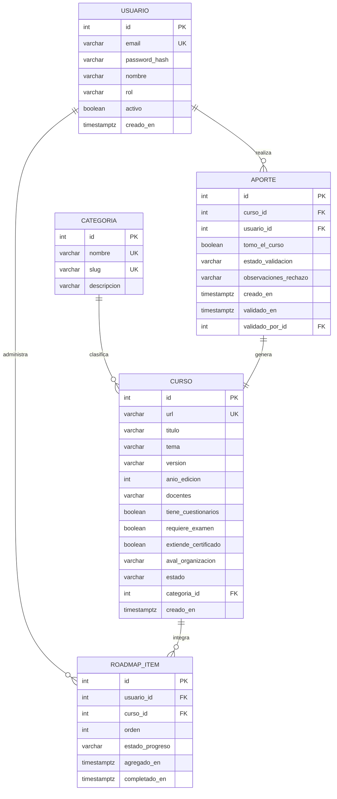
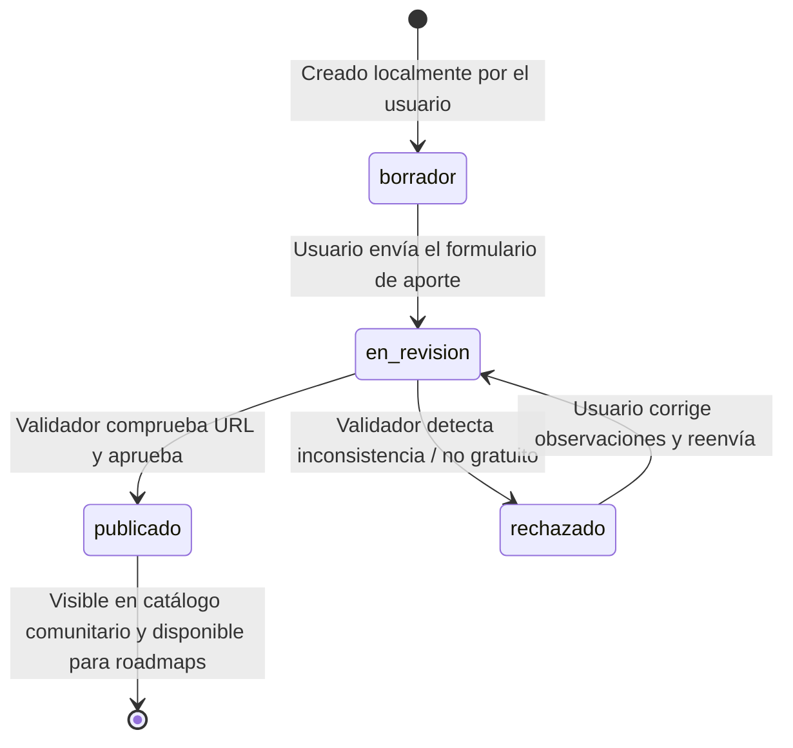

# BackendSchema — Modelo de Datos y Contratos de API REST — OpenRoadmap

> **Qué es:** Define el contrato formal de persistencia en PostgreSQL 18.6 y la superficie de endpoints de la API REST construida con FastAPI. Sustenta los requerimientos técnicos del [TRD](TRD.md) y responde a las necesidades de navegación del [APPFlow](APPFlow.md).

## 1. Modelo de Datos Relacional

### 1.1 Diagrama Entidad-Relación (Mermaid)



### 1.2 Diccionario de Tablas (PostgreSQL 18.6)

#### Tabla: `usuarios`
| Columna | Tipo SQL | Constraints | Descripción |
|---------|----------|-------------|-------------|
| `id` | `SERIAL` | `PRIMARY KEY` | Identificador único interno. |
| `email` | `VARCHAR(255)` | `NOT NULL, UNIQUE` | Correo electrónico de inicio de sesión. |
| `password_hash` | `VARCHAR(255)` | `NOT NULL` | Hash generado con bcrypt (12 rondas de salteo). |
| `nombre` | `VARCHAR(120)` | `NOT NULL` | Nombre o alias público del usuario. |
| `rol` | `VARCHAR(20)` | `NOT NULL, DEFAULT 'estudiante'` | Rol del usuario (`estudiante`, `validador`, `admin`). |
| `activo` | `BOOLEAN` | `NOT NULL, DEFAULT TRUE` | Indicador de cuenta activa. |
| `creado_en` | `TIMESTAMPTZ` | `NOT NULL, DEFAULT CURRENT_TIMESTAMP` | Fecha y hora UTC de registro. |

*Índices:* `CREATE UNIQUE INDEX idx_usuarios_email ON usuarios(LOWER(email));`

#### Tabla: `categorias`
| Columna | Tipo SQL | Constraints | Descripción |
|---------|----------|-------------|-------------|
| `id` | `SERIAL` | `PRIMARY KEY` | Identificador único. |
| `nombre` | `VARCHAR(80)` | `NOT NULL, UNIQUE` | Nombre de la categoría (ej. "Frontend", "Backend", "DevOps"). |
| `slug` | `VARCHAR(80)` | `NOT NULL, UNIQUE` | Identificador amigable para URLs. |
| `descripcion` | `VARCHAR(255)` | `NULL` | Breve texto descriptivo. |

#### Tabla: `cursos`
| Columna | Tipo SQL | Constraints | Descripción |
|---------|----------|-------------|-------------|
| `id` | `SERIAL` | `PRIMARY KEY` | Identificador único del curso. |
| `url` | `VARCHAR(2048)` | `NOT NULL, UNIQUE` | Enlace web activo al contenido original. |
| `titulo` | `VARCHAR(250)` | `NOT NULL` | Título del curso. |
| `tema` | `VARCHAR(150)` | `NOT NULL` | Tema específico (ej. "FastAPI", "React 19", "PostgreSQL"). |
| `version` | `VARCHAR(50)` | `NOT NULL` | Versión del contenido (ej. "v2", "2026", "Edición 3"). |
| `anio_edicion` | `INTEGER` | `NOT NULL` | Año de publicación original (ej. 2026). |
| `docentes` | `VARCHAR(255)` | `NOT NULL` | Nombres de docentes o disertantes a cargo. |
| `tiene_cuestionarios` | `BOOLEAN` | `NOT NULL, DEFAULT FALSE` | Flag de inclusión de quizzes o ejercicios. |
| `requiere_examen` | `BOOLEAN` | `NOT NULL, DEFAULT FALSE` | Flag de requerimiento de evaluación final. |
| `extiende_certificado` | `BOOLEAN` | `NOT NULL, DEFAULT FALSE` | Flag de emisión de certificado gratuito. |
| `aval_organizacion` | `VARCHAR(200)` | `NULL` | Nombre de la entidad, empresa o universidad que lo avala. |
| `estado` | `VARCHAR(20)` | `NOT NULL, DEFAULT 'en_revision'` | Estado del ciclo de vida (`borrador`, `en_revision`, `publicado`, `rechazado`). |
| `categoria_id` | `INTEGER` | `NOT NULL, REFERENCES categorias(id)` | Clave foránea a la categoría. |
| `creado_en` | `TIMESTAMPTZ` | `NOT NULL, DEFAULT CURRENT_TIMESTAMP` | Fecha de creación del registro. |

*Índices:*
- `CREATE INDEX idx_cursos_estado ON cursos(estado);`
- `CREATE INDEX idx_cursos_categoria ON cursos(categoria_id);`
- `CREATE INDEX idx_cursos_titulo_tema ON cursos USING GIN (to_tsvector('spanish', titulo || ' ' || tema));` (para búsquedas rápidas).

#### Tabla: `aportes`
| Columna | Tipo SQL | Constraints | Descripción |
|---------|----------|-------------|-------------|
| `id` | `SERIAL` | `PRIMARY KEY` | Identificador del aporte. |
| `curso_id` | `INTEGER` | `NOT NULL, REFERENCES cursos(id) ON DELETE CASCADE` | Curso aportado. |
| `usuario_id` | `INTEGER` | `NOT NULL, REFERENCES usuarios(id)` | Usuario que realizó el aporte. |
| `tomo_el_curso` | `BOOLEAN` | `NOT NULL` | **Declaración obligatoria:** si el aportante cursó o no el material. |
| `estado_validacion` | `VARCHAR(20)` | `NOT NULL, DEFAULT 'pendiente'` | `pendiente`, `aprobado`, `rechazado`. |
| `observaciones_rechazo` | `TEXT` | `NULL` | Motivo documentado en caso de rechazo. |
| `creado_en` | `TIMESTAMPTZ` | `NOT NULL, DEFAULT CURRENT_TIMESTAMP` | Fecha de envío del aporte. |
| `validado_en` | `TIMESTAMPTZ` | `NULL` | Fecha en la que fue auditado. |
| `validado_por_id` | `INTEGER` | `NULL, REFERENCES usuarios(id)` | Moderador o docente que realizó la auditoría. |

#### Tabla: `roadmap_items`
| Columna | Tipo SQL | Constraints | Descripción |
|---------|----------|-------------|-------------|
| `id` | `SERIAL` | `PRIMARY KEY` | Identificador de la relación. |
| `usuario_id` | `INTEGER` | `NOT NULL, REFERENCES usuarios(id) ON DELETE CASCADE` | Titular del roadmap. |
| `curso_id` | `INTEGER` | `NOT NULL, REFERENCES cursos(id) ON DELETE CASCADE` | Curso añadido. |
| `orden` | `INTEGER` | `NOT NULL` | Posición ordinal en el plan de aprendizaje (1, 2, 3...). |
| `estado_progreso` | `VARCHAR(20)` | `NOT NULL, DEFAULT 'pendiente'` | `pendiente`, `en_progreso`, `completado`. |
| `agregado_en` | `TIMESTAMPTZ` | `NOT NULL, DEFAULT CURRENT_TIMESTAMP` | Fecha de inclusión al roadmap. |
| `completado_en` | `TIMESTAMPTZ` | `NULL` | Fecha en la que el usuario marcó finalización. |

*Índices:* `CREATE UNIQUE INDEX idx_roadmap_usuario_curso ON roadmap_items(usuario_id, curso_id);` (garantiza que un curso no se agregue dos veces al mismo roadmap).

---

## 2. Estados del Ciclo de Vida del Curso



| Estado | Quién tiene acceso | Acciones permitidas |
|--------|--------------------|---------------------|
| `borrador` | Solo el autor del aporte | Modificar campos, enviar a revisión o descartar. |
| `en_revision` | Autor y usuarios con rol `validador` | Validador: inspeccionar y aprobar o rechazar con mensaje. |
| `publicado` | Todo público (sin login requerido) | Visualizar en catálogo, filtrar y agregar a roadmap personal. |
| `rechazado` | Autor y rol `validador` | Autor puede consultar motivo de rechazo y editar para reintentar. |

---

## 3. Especificación de la API REST

**Convenciones globales:**
- Prefijo de versión: `/api/v1`
- Formato de intercambio: `application/json` (UTF-8)
- Paginación estandarizada en listados:
  ```json
  {
    "items": [...],
    "total": 45,
    "page": 1,
    "page_size": 20,
    "total_pages": 3
  }
  ```
- Formato unificado de error:
  ```json
  {
    "error": {
      "code": "VALIDATION_ERROR",
      "message": "Uno o más campos contienen errores.",
      "details": [{ "field": "url", "issue": "URL inválida o inaccesible" }]
    }
  }
  ```

### 3.1 Autenticación (`/api/v1/auth`)

| Método | Endpoint | Auth | Parámetros / Body | Códigos HTTP |
|--------|----------|------|-------------------|--------------|
| `POST` | `/api/v1/auth/registro` | Pública | `{ "email": "...", "password": "...", "nombre": "..." }` | **201 Created**<br>**409 Conflict** (email duplicado)<br>**422 Unprocessable** |
| `POST` | `/api/v1/auth/login` | Pública *(Rate Limited 5 req/min)* | Form urlencoded / JSON: `{ "username": "...", "password": "..." }` | **200 OK** `{ "access_token": "...", "token_type": "bearer" }`<br>**401 Unauthorized**<br>**429 Too Many Requests** |
| `GET` | `/api/v1/auth/me` | Bearer Token | Header `Authorization: Bearer <token>` | **200 OK** `{ "id": 1, "email": "...", "nombre": "...", "rol": "..." }`<br>**401 Unauthorized** |

### 3.2 Catálogo Comunitario (`/api/v1/cursos`)

| Método | Endpoint | Auth | Parámetros Query | Códigos HTTP |
|--------|----------|------|------------------|--------------|
| `GET` | `/api/v1/cursos` | Pública | `page=1`, `page_size=20`, `categoria_id=...`, `q=...` | **200 OK** (Listado paginado)<br>**422 Unprocessable** |
| `GET` | `/api/v1/cursos/{id}` | Pública | Path `id` (entero) | **200 OK** (Objeto curso completo)<br>**404 Not Found** |

*Ejemplo de respuesta `GET /api/v1/cursos?page=1&page_size=1`:*
```json
{
  "items": [
    {
      "id": 10,
      "url": "https://www.youtube.com/playlist?list=ejemplo",
      "titulo": "Arquitectura de Software y Docker en Producción",
      "tema": "DevOps & Docker",
      "version": "2026",
      "anio_edicion": 2026,
      "docentes": "Ing. Martín Ramos",
      "tiene_cuestionarios": true,
      "requiere_examen": false,
      "extiende_certificado": true,
      "aval_organizacion": "Comunidad Abierta UTN",
      "estado": "publicado",
      "categoria": { "id": 4, "nombre": "DevOps", "slug": "devops" },
      "declaracion_cursado": {
        "aportado_por_estudiante": "Lucas Gómez",
        "tomo_el_curso": true
      }
    }
  ],
  "total": 1,
  "page": 1,
  "page_size": 1,
  "total_pages": 1
}
```

### 3.3 Aportes y Moderación (`/api/v1/aportes`)

| Método | Endpoint | Auth | Request Body | Códigos HTTP |
|--------|----------|------|--------------|--------------|
| `POST` | `/api/v1/aportes` | Bearer (`estudiante`) | `{ "url": "...", "titulo": "...", "tema": "...", "version": "...", "anio_edicion": 2026, "docentes": "...", "tiene_cuestionarios": true, "requiere_examen": false, "extiende_certificado": true, "aval_organizacion": "...", "categoria_id": 2, "tomo_el_curso": true }` | **201 Created** (estado `en_revision`)<br>**409 Conflict** (URL ya registrada)<br>**422 Unprocessable** |
| `GET` | `/api/v1/aportes/pendientes` | Bearer (`validador`) | Query `page=1`, `page_size=20` | **200 OK** (Lista de aportes en revisión)<br>**403 Forbidden** |
| `POST` | `/api/v1/aportes/{id}/validar` | Bearer (`validador`) | `{ "aprobado": true, "observaciones": null }` | **200 OK** (Transiciona curso a `publicado` o `rechazado`)<br>**403 Forbidden**<br>**404 Not Found** |

### 3.4 Roadmap Personal (`/api/v1/roadmap`)

| Método | Endpoint | Auth | Request Body / Query | Códigos HTTP |
|--------|----------|------|----------------------|--------------|
| `GET` | `/api/v1/roadmap` | Bearer (`estudiante`) | Query `page=1`, `page_size=50` | **200 OK** (Lista ordenada por `orden` con datos embebidos del curso) |
| `POST` | `/api/v1/roadmap/items` | Bearer (`estudiante`) | `{ "curso_id": 10 }` | **201 Created**<br>**409 Conflict** (Curso ya presente en el roadmap)<br>**404 Not Found** (Curso no publicado) |
| `PATCH` | `/api/v1/roadmap/items/{id}` | Bearer (`estudiante`) | `{ "estado_progreso": "en_progreso" }` o `{ "orden": 2 }` | **200 OK**<br>**404 Not Found** |
| `DELETE` | `/api/v1/roadmap/items/{id}` | Bearer (`estudiante`) | — | **204 No Content**<br>**404 Not Found** |

### 3.5 Categorías (`/api/v1/categorias`)

| Método | Endpoint | Auth | Códigos HTTP |
|--------|----------|------|--------------|
| `GET` | `/api/v1/categorias` | Pública | **200 OK** `[{ "id": 1, "nombre": "Frontend", "slug": "frontend" }, ...]` |

---

## 4. Decisiones de Diseño del Esquema

| Decisión | Alternativas descartadas | Justificación |
|----------|--------------------------|---------------|
| **Tabla `categorias` normalizada** | Guardar categoría como string libre o Enum en PostgreSQL. | Permite agregar o editar categorías desde base de datos sin alterar migraciones de schema, facilitando combos cerrados en formularios de aporte. |
| **Separación de tablas `cursos` y `aportes`** | Unificar todo en una sola tabla de cursos con columnas de auditoría. | Desacopla el contenido del catálogo de la metadata de moderación y la relación con el usuario aportante; permite a futuro versionar múltiples aportes sobre un mismo recurso. |
| **Índice único compuesto en `roadmap_items(usuario_id, curso_id)`** | Validación puramente en capa de aplicación. | Garantiza a nivel de motor de base de datos que no existan carreras que dupliquen un curso en el roadmap de un mismo usuario. |
| **Paginación estandarizada por Offset** | Paginación Keyset / Cursor. | La navegación en tablas y catálogos de este dominio se beneficia del salto directo a número de página ("Ir a pág. 3"); el volumen de datos de comunidad no genera penalización apreciable de performance en offset. |
