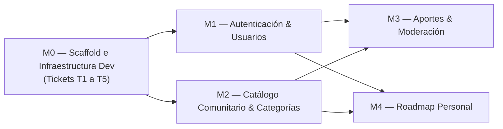

# Implementation Plan — Plan de Implementación por Fases — OpenRoadmap

> **Qué es:** Define la hoja de ruta de construcción del software: partes manejables (módulos), dependencias estrictas, tareas concretas con su **Criterio de Hecho (Definition of Done - DoD)** verificable sin ambigüedades, y su correspondencia con los tickets de la **Instancia B**.

## 1. Definición de MVP (Historias P0)

El criterio de completitud del MVP se valida cuando, en una máquina limpia sin instalaciones previas, se ejecuta:
```bash
docker compose up --build
```
y es posible verificar de punta a punta en el navegador las siguientes historias del [PRD](PRD.md):
- **US-001 (P0):** Visualizar el catálogo comunitario paginado en `http://localhost:5173/catalogo`, filtrar por categorías y buscar por texto.
- **US-002 (P0):** Aportar un curso gratuito completando los 10 metadatos obligatorios y la declaración de cursado (`tomo_el_curso`).
- **US-003 (P0):** Agregar un curso publicado a "Mi Roadmap" y consultar la secuencia de estudio en `/roadmap`.
- **US-004 (P0):** Registrarse, iniciar sesión con JWT y comprobar el bloqueo por rate limiting tras 5 intentos fallidos en `/api/v1/auth/login`.
- **US-005 (P0):** Ingresar como validador, revisar un curso en estado `en_revision` y aprobarlo para que aparezca automáticamente en el catálogo público.

## 2. Grafo de Módulos y Dependencias



*Justificación de dependencias:*
- No es posible implementar ninguna feature sin el scaffold operativo (M0).
- El catálogo público (M2) puede visualizarse sin login, pero los aportes (M3) y el roadmap (M4) requieren un usuario autenticado (M1) y cursos validados del catálogo (M2).

---

## 3. Detalle de Tareas por Módulo

### Módulo M0 — Scaffold Mínimo e Infraestructura (Alcance Instancia B: Tickets T1 a T5)

| # | Ticket | Tarea | Hecho cuando... (DoD) | Est. |
|---|--------|-------|------------------------|------|
| **0.1** | **T1** | **Setup del workflow + scaffold del repo:** Rama `dev`, `CHANGELOG.md` inicial ([Unreleased]), árbol de carpetas Screaming Architecture (`backend/`, `frontend/`, etc.), `.env.example`, `.gitignore`. | La estructura existe en el repo, Git status limpio en rama `dev`. | 30 min |
| **0.2** | **T2** | **Backend mínimo (FastAPI + uv):** Inicialización con `uv init` en `backend/`, agregado de dependencias FastAPI y Uvicorn, creación de `app/main.py` con `GET /health` (`{"status": "ok"}`) y `GET /api/v1/cursos` (datos de prueba). | `curl http://localhost:8000/health` responde status 200 y `GET /api/v1/cursos` devuelve lista de cursos. | 45 min |
| **0.3** | **T3** | **Frontend mínimo (React 19 + Vite + pnpm):** Inicialización con `pnpm create vite` en `frontend/`, pantalla básica que consume `GET /api/v1/cursos` mediante fetch, manejo de 3 estados (loading, error, lista vacía), configuración de proxy en `vite.config.js`. | `pnpm dev` levanta en `http://localhost:5173` y renderiza los datos servidos por el backend. | 1 h |
| **0.4** | **T4** | **Docker Compose de desarrollo:** Archivo `docker-compose.yml` que orquesta los 3 servicios (`postgres:18.6`, `backend` y `frontend`). | `docker compose up` levanta los 3 contenedores sin errores; backend responde en `:8000` y frontend en `:5173`. | 1 h |
| **0.5** | **T5** | **Release v0.1.0 (Cierre del scaffold):** Merges de `feat/T1` a `feat/T4` en `dev`, actualización de `CHANGELOG.md` a `[v0.1.0] - 2026-10-27`, merge de `dev` a `main`, creación del tag anotado `v0.1.0`. | `git tag` lista `v0.1.0`; `main` tiene la historia limpia y verificable. | 30 min |

### Módulo M1 — Autenticación y Control de Acceso

| # | Tarea | Hecho cuando... (DoD) | Est. |
|---|-------|------------------------|------|
| **1.1** | Modelo `usuarios` y hashing bcrypt | Tabla creada en PostgreSQL, contraseñas nunca en claro, tests de hashing verificados. | 1 h |
| **1.2** | Endpoints `/auth/registro` y `/auth/login` | Registro valida email único; login emite JWT válido; credenciales inválidas retornan 401. | 1.5 h |
| **1.3** | Rate limiting en `/auth/login` | Tras 5 peticiones fallidas en 60 segundos desde la misma IP, el sistema retorna 429 Too Many Requests. | 45 min |
| **1.4** | Frontend: Vistas Login y Registro | Formularios conectados al backend, almacenamiento de token y actualización del header con el usuario activo. | 1.5 h |

### Módulo M2 — Catálogo Comunitario y Categorías

| # | Tarea | Hecho cuando... (DoD) | Est. |
|---|-------|------------------------|------|
| **2.1** | Seed de datos inicial | Script o migración que inserta categorías base y al menos 25 cursos publicados para probar paginación. | 45 min |
| **2.2** | Endpoint `GET /api/v1/cursos` paginado | Soporta `page`, `page_size`, filtro por `categoria_id` y búsqueda textual `q`; devuelve payload normalizado con `total_pages`. | 1.5 h |
| **2.3** | Frontend: Grilla de Catálogo + Paginador | Cards con estética Google/Material, chips de categoría interactivos, buscador y paginador responsive. | 2 h |

### Módulo M3 — Aportes de Cursos y Moderación

| # | Tarea | Hecho cuando... (DoD) | Est. |
|---|-------|------------------------|------|
| **3.1** | Endpoint `POST /api/v1/aportes` | Valida URL, 10 metadatos obligatorios y campo `tomo_el_curso`; guarda en estado `en_revision`. | 1.5 h |
| **3.2** | Bandeja de validación `POST /api/v1/aportes/{id}/validar` | Validador autenticado puede aprobar (pasa a `publicado`) o rechazar con observaciones documentadas. | 1.5 h |
| **3.3** | Frontend: Formulario `/aportar` y Panel `/validar` | Formulario mobile-first con feedback visual inline y tabla de moderación accesible para rol validador. | 2 h |

### Módulo M4 — Roadmap Personal de Aprendizaje

| # | Tarea | Hecho cuando... (DoD) | Est. |
|---|-------|------------------------|------|
| **4.1** | Endpoints de gestión de Roadmap | `POST /roadmap/items` (agrega curso con orden), `GET /roadmap` (lista ordenada), `PATCH` (cambia estado), `DELETE` (elimina). | 1.5 h |
| **4.2** | Frontend: Vista `/roadmap` | Lista secuencial de cursos con indicadores de progreso (`pendiente`, `en_progreso`, `completado`) y botón para reordenar o eliminar. | 2 h |

---

## 4. Matriz de Seguimiento de Ejecución (Instancia B)

| Tarea | Módulo | Prioridad | Estado | Rama de trabajo / Commit |
|-------|--------|-----------|--------|--------------------------|
| T1: Scaffold y estructura de carpetas | M0 | P0 | `[ ]` | `feat/T1-scaffold-estructura` |
| T2: Backend mínimo (FastAPI + uv) | M0 | P0 | `[ ]` | `feat/T2-backend-minimo` |
| T3: Frontend mínimo (React + Vite) | M0 | P0 | `[ ]` | `feat/T3-frontend-minimo` |
| T4: Docker Compose de desarrollo | M0 | P0 | `[ ]` | `feat/T4-docker-compose-dev` |
| T5: Release v0.1.0 y cierre de scaffold | M0 | P0 | `[ ]` | `release: scaffold minimo` (tag v0.1.0) |
| Aporte de cursos con metadatos y declaración | M3 | P0 | `[ ]` | `feat/aportes-cursos` |
| Catálogo paginado con filtros | M2 | P0 | `[ ]` | `feat/catalogo-paginado` |
| Roadmap personal del estudiante | M4 | P0 | `[ ]` | `feat/roadmap-personal` |
| Autenticación JWT y rate limiting | M1 | P0 | `[ ]` | `feat/auth-seguridad` |

---

## 5. Estrategia de Testing

- **Tests unitarios (Services puros):**
  - Validación de reglas de negocio aisladas: unicidad de URLs, cálculo del orden consecutivo en el roadmap, transiciones válidas de la máquina de estados de cursos (`borrador` -> `en_revision` -> `publicado`).
  - Patrón AAA (Arrange-Act-Assert) sin base de datos ni llamadas HTTP.
  - Ejecutables con `pytest`.
- **Tests de integración (Repositories & Endpoints):**
  - Verificación de consultas SQL reales, paginación (`LIMIT` y `OFFSET`) y restricciones de clave foránea e índices únicos contra PostgreSQL en Docker.
- **Frontend tests:**
  - Pruebas de hooks y componentes críticos con Vitest y React Testing Library (renderizado de los 3 estados: loading, error, lista vacía; interacción del paginador).
- **Meta de cobertura:** Cobertura de tests unitarios superior al 80% sobre la capa de servicios.

## 6. Riesgos del Plan y Mitigaciones

| Riesgo detectado | Impacto | Estrategia de Mitigación |
|------------------|---------|--------------------------|
| **Complejidad del formulario de aporte (10+ metadatos obligatorios)** | Alto | Modelar un esquema Pydantic en backend y validación de formulario unificada en frontend con feedback visual inmediato en cada campo. |
| **Tiempo de arranque de base de datos en Docker Compose** | Medio | Configurar `healthcheck` en el servicio `postgres` de Docker y condición `service_healthy` en el backend para evitar caídas por conexión rechazada al iniciar. |
| **Conflictos de concurrencia al reordenar el roadmap** | Bajo | Operaciones de actualización de orden ejecutadas bajo transacciones atómicas en PostgreSQL. |
